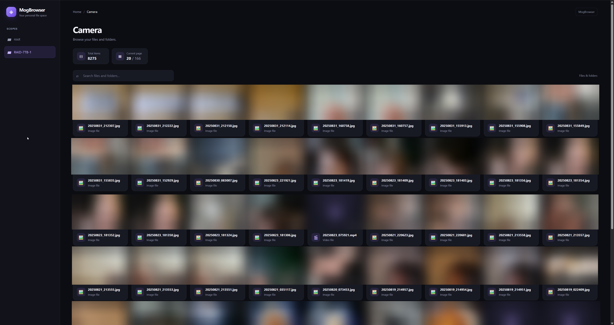

# MogBrowser

A lightweight, self-hosted file browser and media gallery built with Python, Flask, and Jinja2. Browse files and folders through a clean, dark-themed web interface, with support for multiple directory scopes and an interactive media preview.

<p align="center">
  
</p>

## Features

- **Gallery view** — Browse files and folders in a responsive card-based grid.
- **Media preview** — Open images, videos, and audio files in an on-screen modal with playback controls.
- **Thumbnail support** — Display thumbnails for supported media files.
- **Multiple scopes** — Configure multiple directory locations and switch between them from the sidebar.
- **Live search** — Filter files and folders by name on the current page.
- **Pagination** — Navigate large directories in manageable pages.
- **Responsive interface** — Designed to work on desktop and mobile devices.
- **Dark theme** — A modern interface with purple accents.
- **Fast Python environment management** — Uses [`uv`](https://docs.astral.sh/uv/) for dependency management and running the application.

## Requirements

- Python version supported by the project's dependencies.
- [`uv`](https://docs.astral.sh/uv/getting-started/installation/) installed.
- A directory containing the files you want to browse.

## Installation

Clone the repository:

```bash
git clone https://github.com/YOUR_USERNAME/MogBrowser.git
cd MogBrowser
```

Install the project dependencies using `uv`:

```bash
uv sync
```

If the project does not yet define a runnable entry point, use the Python entry-point file directly:

```bash
uv run python app.py
```

Replace `app.py` with the name of your application's entry-point file if it differs.

## Configuration

MogBrowser uses a JSON configuration file to define application settings and the directories available through the browser.

Example configuration:

```json
{
  "debug": true,
  "thumbnail_path": "thumbnails",
  "scopes": {
    "root": {
      "path": "./"
    }
  }
}
```

### Configuration options

| Option | Description |
|---|---|
| `debug` | Enables or disables Flask debug mode. |
| `thumbnail_path` | Directory used to store thumbnails. Relative paths are resolved according to the application's implementation. |
| `scopes` | Defines the directories accessible through the browser. Each scope has a name and a path. |

### Scopes

A scope represents a directory that can be browsed through MogBrowser. Each scope appears in the sidebar, allowing you to switch between configured locations.

The default `root` scope points to the current directory:

```json
"root": {
  "path": "./"
}
```

To add more scopes, create additional entries inside `scopes`, following the same structure.

For example:

```json
{
  "debug": true,
  "thumbnail_path": "thumbnails",
  "scopes": {
    "root": {
      "path": "./"
    },
    "documents": {
      "path": "/home/user/Documents"
    },
    "pictures": {
      "path": "/home/user/Pictures"
    },
    "videos": {
      "path": "/mnt/media/Videos"
    },
    "downloads": {
      "path": "/mnt/media/Downloads"
    }
  }
}
```

Each key (`root`, `documents`, `pictures`, and so on) is the name displayed in the sidebar. Its `path` specifies the directory to browse.

You can add as many scopes as needed, provided the application has permission to access their directories.

**Security note:** Only configure directories you intend to expose. If MogBrowser is accessible to other users or over a network, consider authentication, access controls, and restricting access to trusted clients. Avoid exposing sensitive system directories.

## Running MogBrowser

Start the application using `uv`:

```bash
uv run python -m mogbrowser
```

If the application supports command-line options or a different entry point, use the appropriate command for your setup.

For local development, the application can be configured to use Flask debug mode through the `debug` setting.

**Important:** Do not enable debug mode when exposing the application to an untrusted network or deploying it in production.

## Using the Gallery

Once the application is running, open it in your browser at the address configured by the Flask application.

From the interface, you can:

1. Select a scope from the sidebar.
2. Browse directories by clicking folder cards.
3. Search the current page using the search field.
4. Click image, video, or audio files to open the media preview.
5. Use the preview's close button or press `Esc` to return to the gallery.
6. Use the pagination controls to navigate between pages.

Other file types continue to use the application's normal file-opening route.

## Development

MogBrowser uses `uv` to manage the Python environment and dependencies.

Synchronize dependencies after cloning or updating the project:

```bash
uv sync
```

Run the application:

```bash
uv run python -m mogbrowser
```

Refer to the project's `pyproject.toml` for its configured dependencies, Python requirements, and any project-specific scripts.

## License

See the repository's `LICENSE` file for licensing information.
